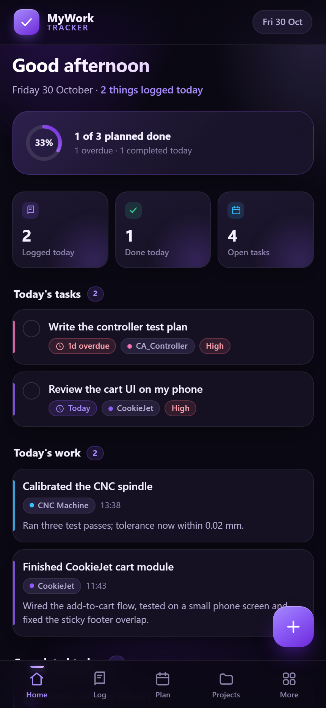
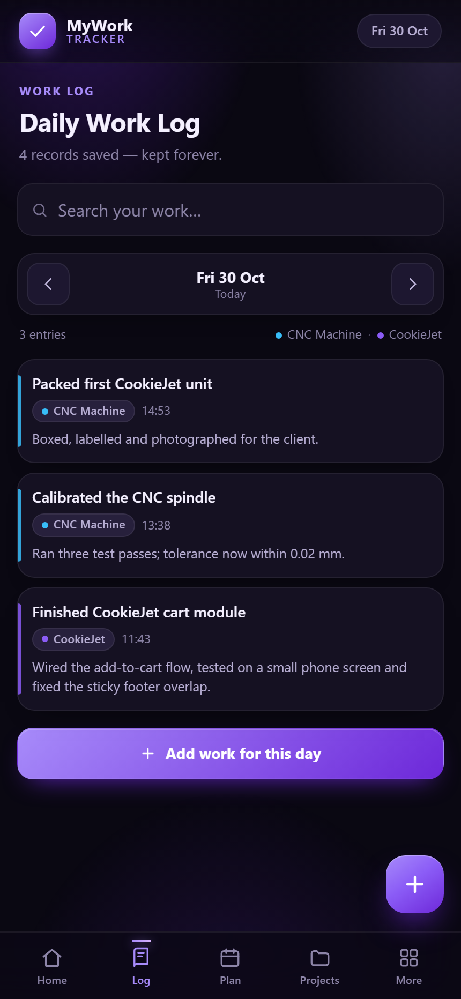

# MyWork Tracker 📱

A personal, mobile-first app to record what you did today, plan what you need to
do next, and keep your complete work history.

**Status: complete — all planned features are built and tested.**
Dashboard, daily work log, future planner, projects, ideas & notes, history &
reports, reminders and backup. See [ROADMAP.md](ROADMAP.md) for what each
feature contains and what is deliberately left out.





## Run it

Option A — one click (Windows):

```
start-app.cmd
```

Option B — any machine with Python:

```
python -m http.server 5599 --bind 127.0.0.1
```

Then open <http://127.0.0.1:5599/>.

Option C — just double-click `index.html`. It works from the file system too
(only the offline cache is unavailable that way).

The app is a plain HTML/CSS/JS app — no build step, no dependencies, no server
logic. Everything is stored on the device.

### Deploy it free

`dist/` (or `mywork-tracker-site.zip`) is the whole website — upload it to any
static host. Full walkthrough: [DEPLOY.md](DEPLOY.md).

| Host | Why |
| --- | --- |
| **Netlify Drop** | drag the `dist` folder, ~1 minute, no git |
| **GitHub Pages** | permanent free link, update with `git push` |
| **Cloudflare Pages** | fastest, unlimited static bandwidth |
| **Vercel** | `npx vercel dist --prod` |

All of them provide free HTTPS, which the installed app needs. Export your data
(**History → Backup → Export**) before switching address, then **Import** it on
the new one — browser storage belongs to the address.

Regenerate the upload folder any time with:

```
npm run build
```

### Use it on your phone

1. Run `.\serve.ps1 -Lan` (same Wi-Fi as the PC) and note the printed address.
2. Open `http://<your-pc-ip>:5599` on the phone.
3. Use the browser menu → **Add to Home screen**. It then opens full-screen
   like a normal app and keeps working offline.

## What works right now

- **Dashboard** — greeting, progress ring, three counters, then **Today's tasks**
  (overdue + due today), **Today's work**, **Completed today** and **Upcoming**
  (future only), sorted by deadline then priority.
- **Daily Work Log** — the Log tab: browse any day (‹ › arrows or the calendar),
  see that day's entries with photo thumbnails, a per-day summary, and
  **Add work for this day**.
- **Photos** — up to 6 per entry, taken or picked from the phone. Images are
  compressed to 1280 px JPEG before saving; tap a photo to view it full-screen.
- **Editing** — tap any entry → **Edit**, change anything, **Save changes**.
  Deleting needs a second tap to confirm.
- **Search** — the Log tab search box matches titles and descriptions across
  your whole history, with the date shown on each result.
- **Future Planner** — the Plan tab groups tasks as Overdue / Today / Tomorrow /
  This week / Later; tap a task to move it to today, tomorrow or next week.
- **Projects** — list of projects with live counts, a detail page with its open
  tasks and recent work, create / rename / recolour, archive and restore.
- **Ideas & Notes** — quick notes with search, pinning and editing.
- **History & Reports** — rolling 7-day bars, week/month counters, a month
  calendar (darker/lighter by activity, tap a day to open its log) and
  **backup export/import**.
- **Reminders** — give any task a date and time; the app shows an in-app reminder
  and, if you allow notifications, a system notification.
- **Quick add** — the **+** button opens one sheet that starts with **Project**
  (colour-coded chips), then **Day** (Today / Tomorrow / any date), then what you
  did or need to do. The sheet switches between **Work log** and **Task**.
- **Mark done / undo** — tap the circle on a task.
- **Navigation** — Home / Log / Plan / Projects / More.
- **Theme colour** — More → Theme colour: Purple, Blue, Green, Orange, Pink,
  Teal. Applies instantly, survives reloads, remembered per device.
- **Dark theme**, safe-area aware, works from 320 px phones to desktop
  (centred 560 px column).

## Where your data lives

Records are stored in the browser under the `mwt.data.v1` key (localStorage),
as a versioned JSON document:

```js
{
  version: 1,
  projects: [{ id, name, color, createdAt, archived }],
  work:     [{ id, title, description, projectId, date, createdAt, updatedAt,
               photos: [{ id, src, w, h, addedAt }] }],
  tasks:    [{ id, title, notes, projectId, dueDate, priority, done,
               completedAt, completedOn, remindAt, remindedAt, createdAt, updatedAt }],
  notes:    [{ id, title, body, pinned, createdAt, updatedAt }]
}
```

Notes on durability:

- Data stays until the browser's site data is cleared. Records are never
  auto-deleted.
- The store is defensive: unreadable JSON is copied to
  `mwt.data.v1.corrupt.<timestamp>` instead of being thrown away, and missing
  fields are repaired on load.
- Backup/restore (export/import JSON) already exists in the data layer; a UI
  button arrives with the History & Reports feature.
- Data is per-browser/per-device. Phone and laptop do not share data yet —
  backup + import is the planned bridge.
- The chosen theme is kept separately under `mwt.theme` (it is not part of your
  work records, so restoring a backup never changes your colours).
- Photos are compressed and stored inside the record, so one entry stays
  self-contained. If the browser storage is full, the write is refused and
  rolled back with a clear message — nothing is silently lost.

## Project structure

```
index.html               app shell, meta tags, PWA manifest link, theme boot
css/styles.css           design system + 6 colour themes, mobile-first layout
js/store.js              data layer: schema, CRUD, day/search queries, backup
js/app.js                router, dashboard, log, planner, projects, notes, reports
sw.js                    offline cache (network-first, cache fallback)
manifest.webmanifest     installable app metadata
icons/                   app icons (SVG + PNG, incl. maskable)
tests/store.test.js      data-layer tests (node --test)
tools/ui-smoke.mjs       real-browser UI test + screenshots (Chrome DevTools)
tools/build-dist.mjs     builds dist/ (the folder you upload)
tools/make_icons.py      icon generator
serve.ps1, start-app.cmd local static server / launcher
dist/                    deploy-ready copy of the site (npm run build)
mywork-tracker-site.zip  dist/ zipped, for drag-and-drop hosts
DEPLOY.md                step-by-step free hosting guide
```

## Tests

```
npm test        # 26 data-layer tests
npm run test:ui # 134 browser checks + screenshots (needs the app served on :5599)
```

`npm run test:ui` drives Chrome headless and writes `tools/shots/*.png`. Both
suites also pass when the app is opened straight from `index.html`.

## Design decisions

- **Manual entry only** — no timers, no tracking in the background.
- **Local-first** — the app is a set of static files; nothing leaves the device.
- **One storage key, one schema version** — migrations stay simple as features
  are added.
- **Photos stay with their record** — compressed to JPEG data URLs so a backup
  is a single JSON file; storage limits are checked rather than ignored.
- **Honest reminders** — a web app cannot wake itself while closed, so reminders
  fire while the app is open and catch up the next time it opens.
- **Progressive** — each feature ships working, tested and usable on its own.
